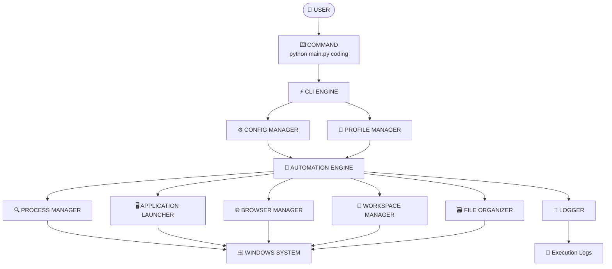
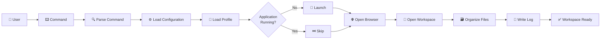
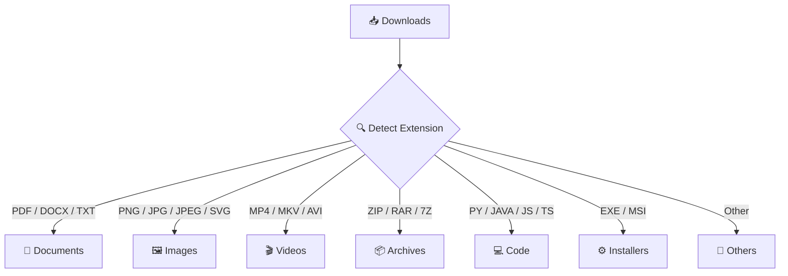
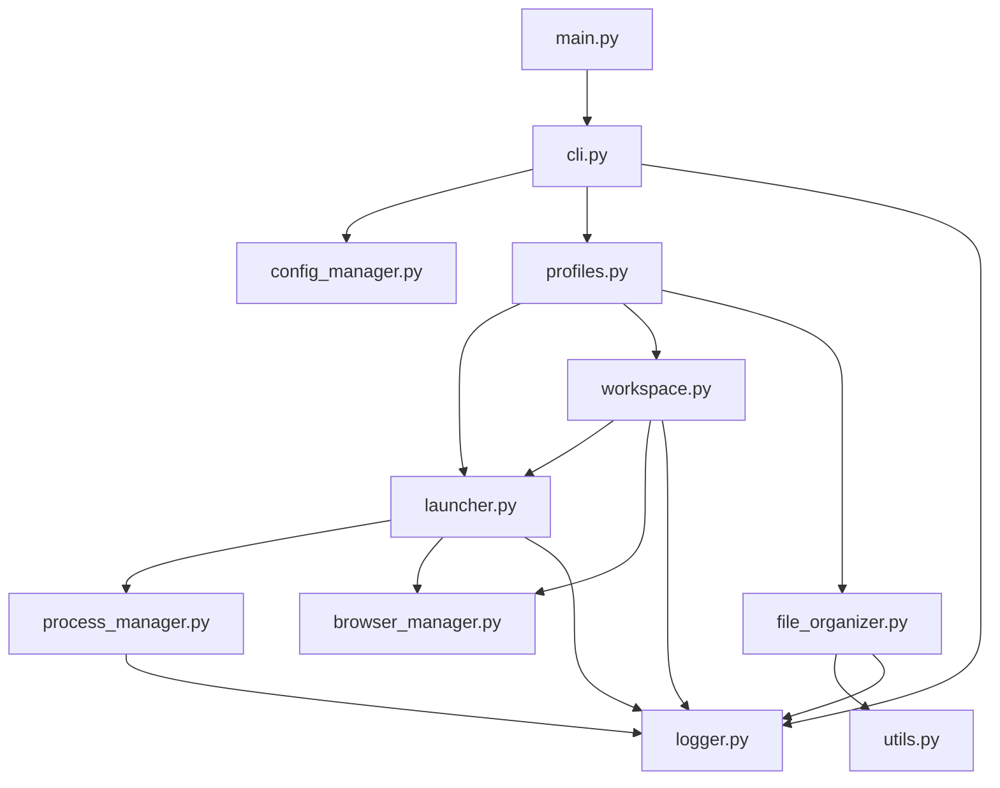
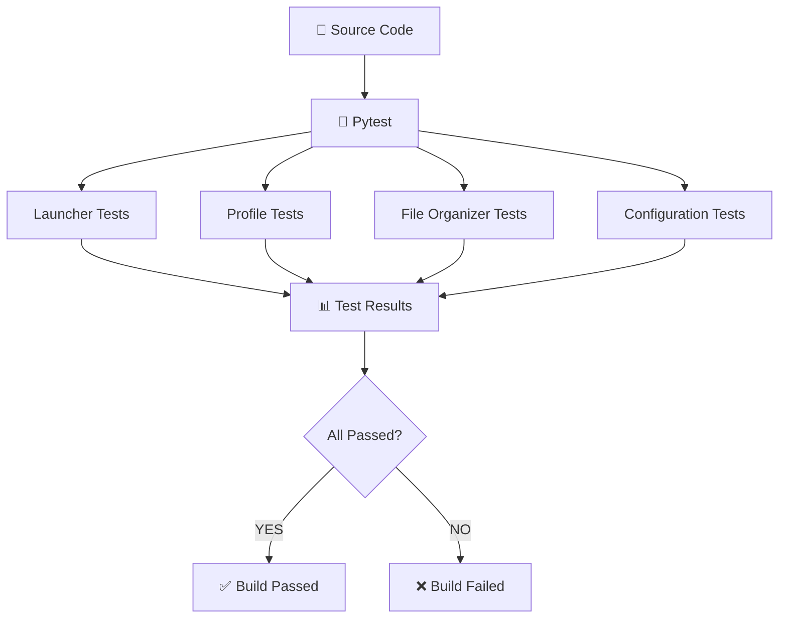
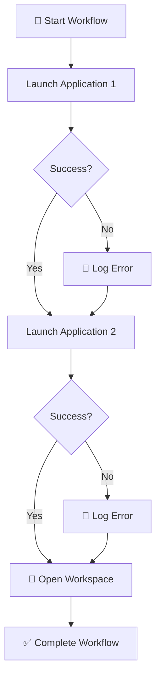
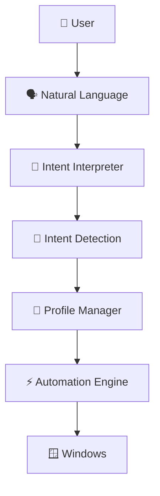
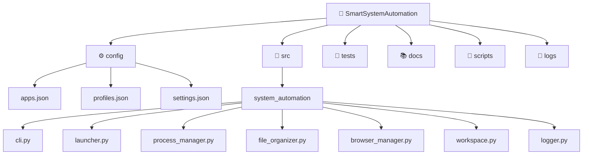
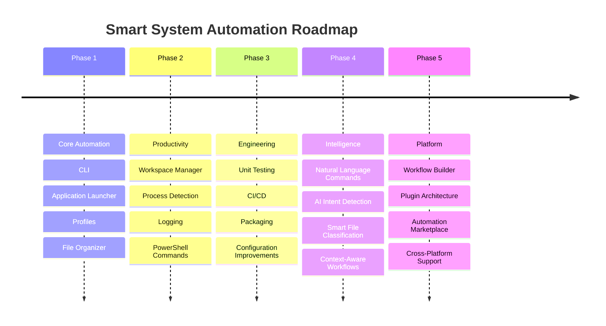

<<<<<<< HEAD
# ⚡ Smart System Automation

<p align="center">


</p>

<p align="center">

### 🚀 Command-Driven Windows Automation Framework

**Automate applications • Organize files • Manage workspaces • Launch workflows**

</p>

---

## 🧠 What Is This?

**Smart System Automation** is a modular Windows automation framework built with Python.

The idea is simple:

> Instead of repeatedly preparing your computer manually, define your workflows once and launch them with a single command.

For example:

```powershell
python main.py coding
```

can transform this:

```text
Open Chrome
    ↓
Open GitHub
    ↓
Open LeetCode
    ↓
Open VS Code
    ↓
Find Project Folder
    ↓
Open Terminal
    ↓
Start Working
```

into this:

```text
                    ⚡ ONE COMMAND
                         │
                         ▼
                 python main.py coding
                         │
                         ▼
                ┌─────────────────┐
                │ AUTOMATION CORE │
                └────────┬────────┘
                         │
          ┌──────────────┼──────────────┐
          ▼              ▼              ▼
      🖥️ Apps         🌐 Browser      📂 Files
          │              │              │
          └──────────────┼──────────────┘
                         ▼
                  🚀 WORKSPACE READY
```

---

# 🎯 Project Goals

```text
┌───────────────────────────────────────────────────────────────┐
│                    SMART AUTOMATION                           │
├───────────────────────────────────────────────────────────────┤
│                                                               │
│  ⚡ Reduce repetitive actions                                 │
│  🧩 Create reusable workflows                                 │
│  🖥️ Control Windows applications                              │
│  📂 Automatically organize files                              │
│  🌐 Prepare browser workspaces                                │
│  💻 Launch development environments                           │
│  📊 Monitor automation execution                              │
│  🧪 Test automation components                                │
│  🔄 Support CI/CD                                             │
│  🤖 Prepare architecture for future AI commands               │
│                                                               │
└───────────────────────────────────────────────────────────────┘
```

---

# ✨ Features

| Feature | Description |
|---|---|
| ⚡ CLI Automation | Execute workflows from the terminal |
| 🧩 Profiles | Create coding, study, placement and custom profiles |
| 🖥️ App Launcher | Launch required Windows applications |
| 🔍 Process Detection | Avoid launching applications that are already running |
| 🌐 Browser Manager | Open predefined websites and resources |
| 📂 File Organizer | Automatically classify and organize files |
| 🗂️ Workspace Manager | Prepare project-specific environments |
| 📝 Logging | Track automation activity and errors |
| ⚙️ JSON Configuration | Configure applications without modifying source code |
| 🧪 Testing | Automated tests using Pytest |
| 🔄 CI/CD | GitHub Actions integration |
| 🤖 AI Ready | Architecture designed for future natural-language commands |

---

# 🏗️ System Architecture



---

# 🔄 Complete Automation Flow



---

# 🖥️ Example: Coding Profile

When the user executes:

```powershell
python main.py coding
```

the system can prepare:

```text
                 🧑‍💻 CODING PROFILE
                         │
          ┌──────────────┼──────────────┐
          │              │              │
          ▼              ▼              ▼
      🖥️ Apps         🌐 Websites      📂 Folders
          │              │              │
          ▼              ▼              ▼
       VS Code         GitHub         Projects
       Terminal        LeetCode       Source Code
       Chrome          Docs           Workspace
```

---

# 💻 CLI Preview

```text
PS C:\SmartSystemAutomation> python main.py

╔══════════════════════════════════════════════════════════════╗
║                                                              ║
║              ⚡ SMART SYSTEM AUTOMATION                      ║
║                                                              ║
║              Windows Productivity Framework                  ║
║                                                              ║
╠══════════════════════════════════════════════════════════════╣
║                                                              ║
║   [1] 🧑‍💻 Coding Workspace                                  ║
║   [2] 📚 Study Workspace                                     ║
║   [3] 💼 Placement Workspace                                 ║
║   [4] 📂 File Organizer                                      ║
║   [5] 📊 System Status                                       ║
║   [6] ⚙️  Settings                                           ║
║   [7] 🚪 Exit                                                ║
║                                                              ║
╚══════════════════════════════════════════════════════════════╝

Select an option: 1

[INFO] Loading configuration...
[INFO] Loading coding profile...
[INFO] Checking running processes...

[✓] Visual Studio Code
[✓] Chrome
[✓] Terminal

[INFO] Opening workspace...
[✓] GitHub
[✓] LeetCode
[✓] Project directory

╔══════════════════════════════════════════════════════════════╗
║ 🚀 CODING WORKSPACE READY                                   ║
╚══════════════════════════════════════════════════════════════╝
```

---

# 🧩 Supported Profiles

```text
profiles/
│
├── 🧑‍💻 coding
│   ├── VS Code
│   ├── GitHub
│   ├── LeetCode
│   ├── Terminal
│   └── Development Projects
│
├── 📚 study
│   ├── Browser
│   ├── PDF Reader
│   ├── Notes
│   └── Study Materials
│
├── 💼 placement
│   ├── Resume
│   ├── LinkedIn
│   ├── Job Portals
│   ├── Coding Platforms
│   └── Preparation Folder
│
└── 🎮 custom
    └── User-defined workflow
```

---

# 📂 Smart File Organization

The file organizer analyzes extensions and moves files according to configured rules.



Example result:

```text
Downloads/
│
├── 📄 Documents/
│   ├── resume.pdf
│   └── notes.docx
│
├── 🖼️ Images/
│   ├── screenshot.png
│   └── photo.jpg
│
├── 🎬 Videos/
│   └── tutorial.mp4
│
├── 📦 Archives/
│   └── project.zip
│
├── 💻 Code/
│   ├── solution.py
│   └── program.java
│
├── ⚙️ Installers/
│   └── application.exe
│
└── 📁 Others/
```

---

# 🗃️ Project Structure

```text
SmartSystemAutomation/
│
├── .github/
│   └── workflows/
│       ├── ci.yml
│       └── release.yml
│
├── config/
│   ├── apps.json
│   ├── profiles.json
│   └── settings.json
│
├── src/
│   └── system_automation/
│       │
│       ├── __init__.py
│       │
│       ├── cli.py
│       │     └── Command-line interface
│       │
│       ├── launcher.py
│       │     └── Application launching
│       │
│       ├── profiles.py
│       │     └── Workflow profiles
│       │
│       ├── file_organizer.py
│       │     └── File classification
│       │
│       ├── process_manager.py
│       │     └── Running-process detection
│       │
│       ├── browser_manager.py
│       │     └── Browser automation
│       │
│       ├── workspace.py
│       │     └── Workspace preparation
│       │
│       ├── config_manager.py
│       │     └── Configuration loading
│       │
│       ├── logger.py
│       │     └── Logging system
│       │
│       └── utils.py
│             └── Shared utilities
│
├── scripts/
│   ├── install.ps1
│   ├── setup.ps1
│   └── uninstall.ps1
│
├── tests/
│   ├── test_launcher.py
│   ├── test_profiles.py
│   ├── test_file_organizer.py
│   └── test_config.py
│
├── docs/
│   ├── architecture.md
│   ├── commands.md
│   └── configuration.md
│
├── logs/
│   └── .gitkeep
│
├── workspace/
│   └── .gitkeep
│
├── .gitignore
├── LICENSE
├── README.md
├── main.py
├── pyproject.toml
└── requirements.txt
```

---

# 🧬 Module Dependency Graph



---

# ⚙️ Configuration

The framework avoids hard-coded application paths wherever possible.

### `apps.json`

```json
{
    "applications": {
        "vscode": "C:/Program Files/Microsoft VS Code/Code.exe",
        "chrome": "C:/Program Files/Google/Chrome/Application/chrome.exe",
        "terminal": "C:/Windows/System32/cmd.exe"
    }
}
```

### `profiles.json`

```json
{
    "coding": {
        "applications": [
            "vscode",
            "chrome",
            "terminal"
        ],
        "websites": [
            "https://github.com",
            "https://leetcode.com"
        ],
        "folders": [
            "D:/Projects"
        ]
    },

    "study": {
        "applications": [
            "chrome"
        ],
        "websites": [
            "https://classroom.google.com"
        ],
        "folders": [
            "D:/Study"
        ]
    },

    "placement": {
        "applications": [
            "chrome",
            "vscode"
        ],
        "websites": [
            "https://www.linkedin.com",
            "https://leetcode.com"
        ],
        "folders": [
            "D:/Placement"
        ]
    }
}
```

---

# 🐍 Core Python Example

A simplified automation engine:

```python
class AutomationEngine:

    def __init__(self, config, logger):
        self.config = config
        self.logger = logger

    def launch_profile(self, profile_name):

        profile = self.config.get_profile(profile_name)

        if not profile:
            raise ValueError(
                f"Unknown profile: {profile_name}"
            )

        self.logger.info(
            "Starting profile: %s",
            profile_name
        )

        self._launch_applications(
            profile.get("applications", [])
        )

        self._open_websites(
            profile.get("websites", [])
        )

        self._open_folders(
            profile.get("folders", [])
        )

        self.logger.info(
            "Profile '%s' completed",
            profile_name
        )
```

---

# 🔍 Process Detection

One important part of the system is avoiding unnecessary duplicate application launches.

```python
def is_running(process_name: str) -> bool:

    for process in get_running_processes():

        if process.name.lower() == process_name.lower():
            return True

    return False
```

Workflow:

```text
             Launch Application
                    │
                    ▼
             Process Manager
                    │
              ┌─────┴─────┐
              │           │
             YES          NO
              │           │
              ▼           ▼
          ⏭️ Skip      🚀 Launch
```

---

# 🚀 Application Launcher

```python
import subprocess


def launch_application(path: str):

    try:

        subprocess.Popen(
            [path],
            shell=False
        )

        print(f"[✓] Launched: {path}")

    except FileNotFoundError:

        print(f"[✗] Application not found: {path}")

    except Exception as error:

        print(f"[!] Launch failed: {error}")
```

---

# 🌐 Browser Manager

```python
import webbrowser


def open_websites(websites):

    for url in websites:

        try:

            webbrowser.open_new_tab(url)

            print(f"[✓] Opened: {url}")

        except Exception as error:

            print(
                f"[✗] Could not open {url}: {error}"
            )
```

---

# 📂 File Organizer

```python
from pathlib import Path
import shutil


FILE_RULES = {

    ".pdf": "Documents",
    ".docx": "Documents",
    ".txt": "Documents",

    ".png": "Images",
    ".jpg": "Images",
    ".jpeg": "Images",

    ".mp4": "Videos",
    ".mkv": "Videos",

    ".zip": "Archives",
    ".rar": "Archives",

    ".py": "Code",
    ".java": "Code",
    ".js": "Code",
    ".ts": "Code"
}


def organize_directory(directory):

    directory = Path(directory)

    for file in directory.iterdir():

        if not file.is_file():
            continue

        folder_name = FILE_RULES.get(
            file.suffix.lower(),
            "Others"
        )

        destination = directory / folder_name

        destination.mkdir(
            parents=True,
            exist_ok=True
        )

        shutil.move(
            str(file),
            str(destination / file.name)
        )
```

---

# 📝 Logging

The project uses structured logging instead of relying only on `print()`.

Example:

```python
import logging


logging.basicConfig(
    level=logging.INFO,
    format=(
        "%(asctime)s | "
        "%(levelname)s | "
        "%(message)s"
    )
)

logger = logging.getLogger("SmartAutomation")
```

Example output:

```text
2026-10-05 20:15:03 | INFO | Starting coding profile
2026-10-05 20:15:04 | INFO | Loading configuration
2026-10-05 20:15:04 | INFO | Checking VS Code
2026-10-05 20:15:05 | INFO | VS Code launched
2026-10-05 20:15:05 | INFO | Chrome already running
2026-10-05 20:15:06 | INFO | Opening workspace
2026-10-05 20:15:07 | INFO | Workspace ready
```

---

# 🧪 Testing Architecture



Run tests:

```bash
pytest
```

Verbose:

```bash
pytest -v
```

Example:

```text
==================== test session starts ====================

tests/test_launcher.py .............       PASSED
tests/test_profiles.py ........           PASSED
tests/test_file_organizer.py ......       PASSED
tests/test_config.py ...........          PASSED

==================== 38 passed ===============================
```

---

# 🔄 CI/CD Pipeline

```mermaid
flowchart LR

    DEV["👨‍💻 Developer"]

    GIT["git add ."]
    COMMIT["git commit"]
    PUSH["git push"]

    ACTION["⚙️ GitHub Actions"]

    PYTHON["🐍 Setup Python"]

    DEPS["📦 Install Dependencies"]

    TEST["🧪 Run Tests"]

    LINT["🔍 Lint Code"]

    BUILD["📦 Build"]

    RELEASE["🚀 Release"]

    DEV --> GIT
    GIT --> COMMIT
    COMMIT --> PUSH

    PUSH --> ACTION
    ACTION --> PYTHON
    PYTHON --> DEPS
    DEPS --> TEST
    TEST --> LINT
    LINT --> BUILD
    BUILD --> RELEASE
```



---

# 📊 GitHub Actions Example

```yaml
name: CI

on:
  push:
    branches:
      - main
      - develop

  pull_request:
    branches:
      - main

jobs:

  test:

    runs-on: windows-latest

    steps:

      - name: Checkout
        uses: actions/checkout@v4

      - name: Setup Python
        uses: actions/setup-python@v5
        with:
          python-version: "3.11"

      - name: Install dependencies
        run: |
          python -m pip install --upgrade pip
          pip install -r requirements.txt

      - name: Run tests
        run: |
          pytest -v
```

---

# 🛡️ Error Handling

Automation should not completely fail because one application cannot be opened.



---

# 📈 Automation Metrics

The framework can collect useful execution statistics:

```text
╔══════════════════════════════════════════════╗
║           📊 AUTOMATION STATISTICS           ║
╠══════════════════════════════════════════════╣
║                                              ║
║  Workflows Executed       : 128              ║
║  Successful Workflows     : 121              ║
║  Failed Workflows         : 7                ║
║  Applications Launched   : 486              ║
║  Files Organized          : 1,274            ║
║  Average Execution Time   : 4.8 sec          ║
║                                              ║
╚══════════════════════════════════════════════╝
```

> Metrics shown above are an example of the planned reporting interface, not measured project statistics.

---

# 🧠 AI-Ready Architecture

The long-term objective is to allow natural-language commands.

Current:

```text
python main.py coding
```

Future:

```text
"Start my development environment"
```

The architecture:



Possible future commands:

```text
> Start my coding environment

> Prepare my placement workspace

> Organize my downloads

> Open my Java project

> Start my study environment

> Close my work environment
```

---

# 🧠 Future Intelligent Workflow

```text
USER
 │
 │ "Prepare my placement environment"
 ▼
┌──────────────────────────┐
│ 🤖 COMMAND INTERPRETER   │
└────────────┬─────────────┘
             │
             ▼
      Intent = PLACEMENT
             │
             ▼
┌──────────────────────────┐
│ 🧩 PROFILE MANAGER       │
└────────────┬─────────────┘
             │
             ▼
┌──────────────────────────┐
│ ⚡ AUTOMATION ENGINE     │
└────────────┬─────────────┘
             │
      ┌──────┼──────┐
      ▼      ▼      ▼
     🌐     📂     💻
   Browser Files  Apps
      │      │      │
      └──────┼──────┘
             ▼
       🚀 READY TO WORK
```

---

# 📁 File Organization Architecture



---

# 📦 Installation

## 1. Clone

```bash
git clone YOUR_REPOSITORY_URL
```

```bash
cd SmartSystemAutomation
```

## 2. Create Virtual Environment

```bash
python -m venv .venv
```

## 3. Activate

### CMD

```cmd
.venv\Scripts\activate
```

### PowerShell

```powershell
.venv\Scripts\Activate.ps1
```

## 4. Install Dependencies

```bash
pip install -r requirements.txt
```

## 5. Run

```bash
python main.py
```

---

# ⚡ Quick Commands

```bash
# Show available profiles
python main.py --list

# Start coding environment
python main.py coding

# Start study environment
python main.py study

# Start placement environment
python main.py placement

# Organize files
python main.py organize

# Show system status
python main.py status

# Show help
python main.py --help
```

---

# 🔧 PowerShell Integration

The project can eventually expose commands directly through PowerShell.

Instead of:

```powershell
python main.py coding
```

the goal is:

```powershell
start coding
```

or:

```powershell
start placement
```

Example command mapping:

```powershell
function Start-Coding {
    python "C:\SmartSystemAutomation\main.py" coding
}

function Start-Study {
    python "C:\SmartSystemAutomation\main.py" study
}

function Start-Placement {
    python "C:\SmartSystemAutomation\main.py" placement
}
```

---

# 🧪 Development Workflow

```text
       👨‍💻 CODE
          │
          ▼
     🧪 WRITE TEST
          │
          ▼
     🔍 RUN LINTER
          │
          ▼
      🧪 PYTEST
          │
          ▼
       📦 BUILD
          │
          ▼
      🚀 PUSH GITHUB
          │
          ▼
    ⚙️ GITHUB ACTIONS
          │
          ▼
       ✅ VERIFIED
```

---

# 🔐 Security

Never commit sensitive information.

```gitignore
# Python
__pycache__/
*.py[cod]

# Virtual environment
.venv/
venv/

# Environment variables
.env
.env.*

# Logs
logs/*.log

# Local configuration
config/local.json

# IDE
.vscode/
.idea/

# OS
Thumbs.db
Desktop.ini
```

Never store:

```text
❌ Passwords
❌ API Keys
❌ Access Tokens
❌ Personal Credentials
❌ Private Configuration
```

---

# 🛠️ Technology Stack

```text
┌────────────────────────────────────────────────────────────┐
│                     TECHNOLOGY STACK                       │
├────────────────────────────────────────────────────────────┤
│                                                            │
│  🐍 Python             → Automation Engine                 │
│  🪟 Windows            → Target Platform                   │
│  📄 JSON               → Configuration                     │
│  💻 PowerShell         → Windows Integration               │
│  🧪 Pytest             → Testing                           │
│  🔀 Git                → Version Control                   │
│  🐙 GitHub             → Repository                        │
│  ⚙️ GitHub Actions     → CI/CD                             │
│  📊 Mermaid            → Architecture Visualization        │
│                                                            │
└────────────────────────────────────────────────────────────┘
```

---

# 📚 Engineering Concepts

This project demonstrates practical implementation of:

```text
🐍 Python
 ├── OOP
 ├── Modules
 ├── Exception Handling
 ├── File Handling
 ├── JSON
 └── Logging

🖥️ Windows
 ├── Process Management
 ├── Application Launching
 ├── File System Operations
 └── PowerShell Integration

⚙️ Software Engineering
 ├── Modular Architecture
 ├── Separation of Concerns
 ├── Configuration Management
 ├── Error Handling
 └── Extensibility

🧪 Quality
 ├── Unit Testing
 ├── CI/CD
 └── Automated Validation

🔀 DevOps
 ├── Git
 ├── GitHub
 ├── Branching
 └── GitHub Actions
```

---

# 🗺️ Roadmap



---

# 🚀 Future Architecture

```text
                         ┌─────────────────────┐
                         │     👤 USER         │
                         └──────────┬──────────┘
                                    │
                     ┌──────────────▼──────────────┐
                     │       🗣️ COMMAND LAYER       │
                     │                              │
                     │ CLI + Natural Language + AI │
                     └──────────────┬───────────────┘
                                    │
                         ┌──────────▼──────────┐
                         │   🧠 INTENT ENGINE  │
                         └──────────┬──────────┘
                                    │
                    ┌───────────────▼────────────────┐
                    │       ⚡ AUTOMATION ENGINE       │
                    └───────────────┬─────────────────┘
                                    │
          ┌─────────────────────────┼─────────────────────────┐
          │                         │                         │
          ▼                         ▼                         ▼
   🖥️ APPLICATIONS             📂 FILES                 🌐 WEB
          │                         │                         │
          ▼                         ▼                         ▼
   Process Manager             Organizer              Browser Manager
          │                         │                         │
          └─────────────────────────┼─────────────────────────┘
                                    │
                                    ▼
                           🪟 WINDOWS SYSTEM
```

---

# ⭐ Why This Project Matters

This project is not intended to be just a collection of automation scripts.

It is designed around the idea of building a **reusable automation platform**.

The architecture separates:

```text
COMMAND
   ↓
CONFIGURATION
   ↓
PROFILE
   ↓
AUTOMATION ENGINE
   ↓
SYSTEM SERVICES
   ↓
WINDOWS
```

This makes it easier to add new functionality without rewriting the entire application.

---

# 📌 Project Status

```text
╔════════════════════════════════════════════╗
║             PROJECT STATUS                 ║
╠════════════════════════════════════════════╣
║                                            ║
║  Core Architecture       🟢 Active         ║
║  CLI                     🟢 Active         ║
║  Profiles                🟢 Active         ║
║  Application Launcher    🟢 Active         ║
║  File Organizer          🟢 Active         ║
║  Logging                 🟢 Active         ║
║  Testing                 🟡 Expanding      ║
║  CI/CD                   🟡 Expanding      ║
║  AI Commands             🔵 Planned        ║
║  Workflow Builder        🔵 Planned        ║
║                                            ║
╚════════════════════════════════════════════╝
```

---

# 👨‍💻 Author

## Prudhvi Reddy

**B.Tech — Data Science**

Interested in:

```text
💻 Software Development
📊 Data Science
🤖 Artificial Intelligence
⚙️ Automation
☁️ Cloud Computing
🧩 Developer Tools
```

---

# ⭐ Support

If you find this project useful:

```text
        ⭐ STAR THE REPOSITORY
                 │
                 ▼
        🍴 FORK THE PROJECT
                 │
                 ▼
        🛠️ BUILD YOUR OWN
                 │
                 ▼
        🚀 CONTRIBUTE BACK
```

---

# 📄 License

This project is licensed under the **MIT License**.

See `LICENSE` for details.

---

<p align="center">

### ⚡ Automate the repetitive. Build the intelligent.

**Smart System Automation**

</p>

---

# 🚀 StartMyDay Workspace Automation Tool

A cross-platform, command-driven personal workspace automation tool included in this repository.

Start your complete daily work and study environment with one simple command:

```bash
startmyday
```

## Features

- **One-Command Launch**: Opens your browser tabs (LeetCode, GitHub, ChatGPT, Gmail, Outlook, WhatsApp Web) and VS Code automatically.
- **Daily Notes System**: Automatically creates and opens `daily_notes/YYYY-MM-DD.md` with a structured goal-tracking template.
- **Profiles**:
  - `startmyday` — Full daily workspace
  - `startmyday coding` — Coding workspace (VS Code, GitHub, LeetCode, ChatGPT)
  - `startmyday study` — Study workspace (VS Code, notes, ChatGPT)
  - `startmyday placement` — Placement & career workspace (LinkedIn, GitHub, LeetCode, Gmail, Outlook)
- **JSON Configuration**: Customize URLs, browser preferences, and folders in `config.json` without modifying code.
- **Cross-Platform**: Designed with OS adapters for Windows, macOS, and Linux.
- **Logging**: Keeps track of daily launches and errors in `logs/startmyday.log`.

## Installation & Setup

Install in editable mode:

```bash
pip install -e .
```

Now you can type `startmyday` from any CMD or PowerShell terminal!

